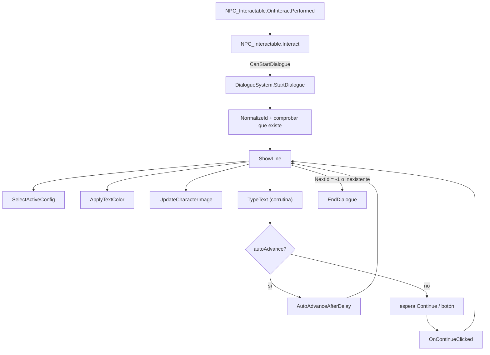

# Dialogue System para Unity

## 1. Qué es y para qué sirve

Sistema de diálogos para Unity que lee los textos de archivos **CSV** y los muestra con efecto de escritura sobre **TextMeshPro**, con retratos de personaje, nombre, colores y hasta dos estilos de interfaz distintos a la vez. Los diálogos se escriben en una hoja de cálculo, no en el código: cada línea indica quién habla, qué dice, con qué expresión y cuál es la siguiente línea. Se controla con el **nuevo Input System** de Unity y se inicia con una sola llamada (`StartDialogue`) o con el componente `NPC_Interactable`, que lo lanza al acercarte a un NPC y pulsar *Interactuar*. Permite varios idiomas (un CSV por idioma), textos de narrador sin imagen ni nombre, y la carpeta del sistema puede estar en **cualquier sitio dentro de `Assets`**.

> **Configuración de prueba.** El zip de la *release* incluye una configuración de prueba ya montada para ver el sistema funcionando sin configurar nada. Va dentro de `Assets` (en cualquier subcarpeta): `Scripts/` contiene el código, `Idiomas/` los CSV de ejemplo (español e inglés) y `Resources/Characters/` los retratos de ejemplo de dos personajes (`tu` y `kimi`).

---

## Índice

1. [Qué es y para qué sirve](#1-qué-es-y-para-qué-sirve)
2. [Uso como desarrollador](#2-uso-como-desarrollador)
3. [Cómo funciona internamente](#3-cómo-funciona-internamente)

---

## 2. Uso como desarrollador

### 2.1 Requisitos

| Requisito | Detalle |
|---|---|
| Unity | 2022.2 o superior (usa `FindAnyObjectByType`) |
| Input System | Paquete **Input System** instalado y activo (*Project Settings > Player > Active Input Handling*) |
| TextMeshPro | Paquete **TextMeshPro** (los textos son `TextMeshProUGUI`) |
| Canvas | Un **Canvas** con al menos un `TextMeshProUGUI` para el texto del diálogo |
| Objeto del sistema | Un GameObject **activo** que lleve el componente `DialogueSystem`. Lo ideal es un objeto **vacío y único** solo para esto |

> **Importante:** no pongas `DialogueSystem` en el mismo objeto que el panel o el texto del diálogo. El sistema oculta ese objeto al arrancar y, si fuera el mismo, se desactivaría a sí mismo.
> Si usas el botón de continuar, el `EventSystem` debe tener el componente **Input System UI Input Module**.

### 2.2 Qué hay en cada carpeta

| Carpeta / archivo | Qué es |
|---|---|
| `Scripts/DialogueSystem.cs` | El sistema: carga el CSV, muestra las líneas y gestiona el input |
| `Scripts/NPC_Interacteable.cs` | Componente `NPC_Interactable`: inicia un diálogo al acercarte a un NPC y pulsar interactuar |
| `Idiomas/*.csv` | Un CSV por idioma con todas las líneas de diálogo (`Dialogue_ES.csv`, `Dialogue_ENG.csv`) |
| `Resources/Characters/<personaje>/<expresion>.png` | Retratos. Deben estar en una carpeta llamada exactamente `Resources` |

La carpeta `Dialogue` puede estar en cualquier subcarpeta de `Assets`. Solo hay que respetar que `Resources` se llame así.

### 2.3 Configurar `DialogueSystem` en el Inspector

Añade el componente `DialogueSystem` a tu objeto vacío y rellena:

**Configuración 1 y Configuración 2** (dos estilos de UI; cada línea del CSV elige cuál usar)

| Campo | ¿Obligatorio? | Qué hace |
|---|---|---|
| `Dialogue Text` | **Sí** | `TextMeshProUGUI` donde se escribe el diálogo. Es el único campo imprescindible |
| `Dialogue Panel` | No | Panel que se muestra/oculta. Si está vacío, se muestra/oculta solo el texto |
| `Name Text` | No | `TextMeshProUGUI` donde sale el nombre del personaje. Vacío = no se muestra nombre |
| `Continue Button` | No | Botón de continuar. Vacío = se avanza solo con las Input Actions |
| `Left / Right Character Image` | No | `Image` donde se muestra el retrato según el lado indicado en el CSV |
| `Auto Advance` | No | Si está activo, la config avanza sola e ignora continuar/saltar |
| `Auto Advance Delay` | No | Segundos de espera tras terminar de escribir antes de pasar a la siguiente línea |

Gracias a que todo es opcional salvo el texto, una config puede ser solo un texto suelto en pantalla (por ejemplo, para un narrador).

**Configuración General**

| Campo | Qué hace |
|---|---|
| `Typing Speed` | Segundos entre letra y letra (por defecto `0.03`) |
| `Csv File Name` | Nombre del CSV a usar, con extensión (ej. `Dialogue_ES.csv`) |
| `Csv Relative Folder` | Carpeta del CSV relativa a `Assets`. Ver [rutas](#25-rutas-y-cambio-de-carpeta) |
| `Characters Resources Path` | Carpeta de retratos dentro de cualquier `Resources` (por defecto `Characters`) |

**Input System**

| Campo | Qué hace |
|---|---|
| `Continue Action` | `InputActionReference` (acción tipo *Button*) que avanza al siguiente texto. Si el texto aún se está escribiendo, lo completa |
| `Skip Action` | `InputActionReference` que completa al instante el texto que se está escribiendo (no salta el diálogo entero) |

Usa acciones distintas de la de interactuar si no quieres que una misma pulsación haga varias cosas. En todo caso el sistema ignora la pulsación que abre el diálogo.

### 2.4 Iniciar un diálogo

**Opción A: con un NPC.** Añade `NPC_Interactable` a un objeto de la escena y configura:

| Campo | Qué hace |
|---|---|
| `Dialogue Start Id` | ID de la primera línea (`1`, `01` y `0001` son lo mismo) |
| `Interaction Range` | Distancia (en unidades) a la que el jugador puede hablar con él |
| `Interact Action` | `InputActionReference` de la acción de interactuar |

El jugador debe tener el **tag `Player`**. Si hay varios NPC al alcance, solo responde el más cercano.

**Opción B: desde código.**

```csharp
DialogueSystem dialogue = FindAnyObjectByType<DialogueSystem>();

dialogue.StartDialogue("1");        // por ID (texto)
dialogue.StartDialogue(10);         // por número: se convierte a hexadecimal -> ID "A"

if (dialogue.CanStartDialogue)      // true si no hay un diálogo en curso
    dialogue.StartDialogue("5");

if (dialogue.IsDialogueActive)      // true mientras hay un diálogo en pantalla
{
    // por ejemplo: bloquear el movimiento del jugador
}

dialogue.ReloadDialogue("Dialogue_ENG.csv");   // cambiar de idioma en caliente
dialogue.ReloadDialogue();                     // recargar el CSV actual
```

| Miembro | Descripción |
|---|---|
| `StartDialogue(string id)` | Inicia el diálogo en la línea con ese ID |
| `StartDialogue(int id)` | Igual, pero el número se interpreta como **hexadecimal** (`10` -> `A`) |
| `ReloadDialogue(string csv = null)` | Recarga el CSV; si se pasa un nombre, cambia antes `csvFileName` |
| `IsDialogueActive` | Hay un diálogo visible ahora mismo |
| `CanStartDialogue` | Se puede iniciar uno (no hay otro en curso ni acaba de cerrarse en este frame) |

Un mismo CSV puede contener **muchas conversaciones**: cada NPC (o cada llamada) empieza en un ID distinto.

### 2.5 Rutas y cambio de carpeta

El CSV se busca así:

1. En la carpeta indicada en **`Csv Relative Folder`** (relativa a `Assets`). Acepta `Dialogue/Idiomas`, `/Dialogue/Idiomas/`, `Assets/Dialogue/Idiomas` o con `\`.
2. Si no está ahí, se **busca automáticamente por todo `Assets`** por el nombre del archivo.

Por eso puedes mover la carpeta `Dialogue` donde quieras y seguirá funcionando; el campo es solo una pista que acelera la búsqueda. Para rellenarlo automáticamente: **clic derecho en el título del componente `DialogueSystem` > `Detectar carpeta del CSV`**.

Los retratos usan `Resources.Load`, así que funcionan en **cualquier carpeta `Resources` de cualquier nivel**. Si quieres otra carpeta base, cambia `Characters Resources Path`.

Si hay dos CSV con el mismo nombre en `Assets`, se avisa por consola y se usa el que esté en una carpeta con el mismo nombre que la pista (ej. `Idiomas`).

### 2.6 Cómo funciona el CSV

Cada **línea** es una frase. La primera fila es la cabecera y **siempre se ignora** (debe existir).

```csv
ID,CharacterName,Text,NextId,Expression,Side,Color,config
1,tu,Hola,2,angry,left,blue,1
2,kimi,"Hola, ¿qué tal?",3,happy,right,red,1
3,,El viento sopla entre los árboles.,4,,,,1
4,tu,Adiós,-1,neutral,left,white,2
```

| Columna | Obligatoria | Qué hace |
|---|---|---|
| `ID` | Sí | Identificador único de la línea. Se escribe en **hexadecimal** (`1`..`9`, `A`..`F`, `10`, `1F`...). Los ceros a la izquierda no importan (`0001` = `1`) y no distingue mayúsculas |
| `CharacterName` | Sí* | Nombre del personaje. **Es el texto que sale en el `Name Text`** y también **el nombre de la carpeta** de retratos (`Resources/Characters/<CharacterName>/`). Vacío = narrador (sin nombre ni retrato) |
| `Text` | Sí | El texto a mostrar. Si contiene comas, pon **entre comillas** todo el texto|
| `NextId` | Sí | ID de la **siguiente línea**. Con **`-1`** el diálogo **termina** |
| `Expression` | No | Nombre del archivo del retrato **sin extensión** (`angry` -> `angry.png`). Vacío = sin retrato |
| `Side` | No | `left` o `right`: qué imagen del Inspector se usa (cualquier otro valor cuenta como `right`) |
| `Color` | No | Color del texto: `blue`, `red`, `green`, `yellow`, `white`, `black`, `purple`, `orange` o un color HTML (`#FF8800`). Vacío = el color que tenga el texto en el Inspector |
| `config` | No | `1` o `2`: qué configuración de UI usar. Vacío = `1` |

\* Puede ir vacío (`5,,Texto,6`), pero la columna debe existir.

**Reglas importantes**

- **Mínimo 4 columnas** (ID, CharacterName, Text, NextId). Las demás pueden omitirse: un narrador puede ser `5,,Texto del narrador,6`.
- **Siguiente texto:** pon en `NextId` el ID de la línea que sigue. Para **terminar**, usa `-1`. Si el ID de `NextId` no existe, el diálogo termina y se avisa por consola.
- **Retratos:** la ruta final es `Resources/<Characters Resources Path>/<CharacterName>/<Expression>.png`. `Expression` se pasa a minúsculas, así que los archivos deben tener **nombre en minúsculas**; `CharacterName` se usa tal cual (respeta mayúsculas). Las imágenes deben importarse como **Sprite (2D and UI)**.
- **Separador:** coma `,` y codificación UTF-8. Ojo: Excel en configuración regional española guarda con `;` por defecto; expórtalo como *CSV UTF-8 separado por comas*.
- **Una línea = una fila:** no se admiten saltos de línea dentro de una celda ni comillas escapadas dentro del texto.
- **Varias conversaciones:** salta a cualquier ID con `NextId`, así que puedes tener varias conversaciones en el mismo archivo o reutilizar líneas.

**Añadir tu propio CSV o un idioma nuevo**

1. Crea un CSV con **exactamente este formato** (misma cabecera) en cualquier carpeta de `Assets`.
2. En el `DialogueSystem`, pon su nombre en **`Csv File Name`** (o llámalo por código con `ReloadDialogue("MiArchivo.csv")`).
3. Mantén los mismos IDs entre idiomas para que todo cuadre con el `Dialogue Start Id` de tus NPC.

### 2.7 Problemas frecuentes

| Síntoma en consola | Causa y solución |
|---|---|
| `No se encontró '...csv' ni en '...' ni en ninguna otra carpeta de Assets` | El nombre de `Csv File Name` no coincide con ningún archivo. Revisa mayúsculas y extensión |
| `ID de diálogo no encontrado` | El `Dialogue Start Id` no existe en el CSV cargado |
| `no hay ningún 'Dialogue Text' asignado` | Arrastra un `TextMeshProUGUI` al campo `Dialogue Text` de la Configuración 1 o 2 |
| `No se encontró la imagen en Resources` | La carpeta/archivo no coincide con `CharacterName`/`Expression`, no está en una carpeta `Resources`, o no está importado como Sprite |
| El NPC no responde | El jugador no tiene tag `Player`, está fuera de `Interaction Range`, o `Interact Action` no está asignada |
| El botón de continuar no funciona | El `EventSystem` no usa *Input System UI Input Module* |

### 2.8 Limitaciones conocidas

- **Solo funciona en el Editor.** Los CSV se leen de la carpeta `Assets` con `System.IO`, y esa carpeta no existe en un juego compilado. Para una *build* habría que cargarlos como `TextAsset` (desde `Resources`) o `StreamingAssets`.
- El texto se escribe **letra a letra**, por lo que las etiquetas de TextMeshPro (`<b>`, `<color>`) pueden verse a medias mientras se escriben.
- No hay opciones de respuesta ni ramificación por elección del jugador: cada línea apunta a una única siguiente línea.

---

## 3. Cómo funciona internamente

Esta sección es para quien quiera modificar el código base.

### 3.1 Visión general

El sistema son dos scripts:

- **`DialogueSystem`** (`MonoBehaviour`): carga el CSV en memoria, controla qué línea se muestra, escribe el texto y gestiona el input.
- **`NPC_Interactable`** (`MonoBehaviour`): detecta al jugador y le pide a `DialogueSystem` que empiece un diálogo.

Además hay dos clases de datos: `DialogueLine` (una fila del CSV) y `DialogueUIConfig` (los elementos de UI de una configuración).



### 3.2 Arranque (`DialogueSystem`)

1. **`OnEnable`** se suscribe a `performed` de `continueAction` y `skipAction` y las habilita.
2. **`Start`** captura el color original del texto de cada config (`CaptureDefaultColor`), oculta todo (`HideConfig`), avisa si no hay ningún `Dialogue Text` asignado y llama a `LoadDialogueFromCSV`.
3. **`LoadDialogueFromCSV`** obtiene la ruta con `FindCsvPath`, vacía el diccionario `allDialogues` (para no mezclar idiomas al recargar), lee el archivo y por cada fila crea un `DialogueLine`.

**Por qué un diccionario por ID:** permite saltar a cualquier línea en O(1) y que el orden de las filas del CSV no importe. La "lista enlazada" la forma el campo `NextId`.

**Por qué `NormalizeId`:** Excel y LibreOffice borran los ceros a la izquierda (`0001` -> `1`), así que el ID se normaliza (mayúsculas, sin ceros, `-1` intacto) tanto al cargar el CSV como en `StartDialogue` y `ShowLine`. Así `0001`, `01` y `1` son la misma clave.

**Por qué las columnas son opcionales (`Column`):** `Column(parts, i)` devuelve `""` si la fila no tiene esa columna, de modo que una línea de narrador puede tener solo 4 campos sin que el parser falle.

### 3.3 Localización del CSV (`FindCsvPath`)

```
FindCsvPath
 ├─ ¿ya resuelta y sigue existiendo?  -> devolver la caché (resolvedCsvPath)
 ├─ SanitizeFolder(csvRelativeFolder) + csvFileName  -> ¿existe?  -> usar
 └─ SearchInAssets(csvFileName)  -> búsqueda recursiva por Application.dataPath
```

- **`SanitizeFolder`** admite `/`, `\`, barras de más y el prefijo `Assets/`. La comparación con `Assets` es **sensible a mayúsculas a propósito**: una subcarpeta propia llamada `assets` (minúscula) no debe recortarse.
- **`SearchInAssets`** filtra por nombre exacto (el patrón de `Directory.GetFiles` puede ser laxo) y descarta rutas que Unity no importa (`IsIgnoredByUnity`: carpetas o archivos que empiezan por `.` o acaban en `~`). Si hay varios resultados, ordena y prefiere el que esté en una carpeta con el mismo nombre que la pista.
- **Por qué existe:** la ruta es un valor serializado en cada componente; al mover la carpeta quedaba desfasada y dejaba de encontrar el archivo. La búsqueda hace que el campo sea solo una optimización, y el *Context Menu* (`AutoDetectCsvFolder`) lo reescribe y marca el objeto como modificado (`SetDirty`).
- **Caché por instancia** (`resolvedCsvPath` / `resolvedCsvFileName`): se invalida si cambia `csvFileName` o el archivo desaparece, así el cambio de idioma no queda atascado con la ruta anterior.

### 3.4 Mostrar una línea (`ShowLine`)

`ShowLine(id)` es el centro del sistema; lo llaman `StartDialogue`, `OnContinueClicked` y `AutoAdvanceAfterDelay`:

1. Normaliza el ID. Si es `-1` o no existe, llama a `EndDialogue` (y avisa si no existía).
2. `SelectActiveConfig(currentLine.config)` decide qué UI usar.
3. Escribe el nombre si hay `nameText`.
4. `ApplyTextColor`: color vacío -> el del Inspector (`defaultTextColor`); nombre conocido -> diccionario `textColors`; si no, `ColorUtility.TryParseHtmlString`; si falla, blanco con aviso.
5. `UpdateCharacterImage`.
6. `StopAllCoroutines()` y `StartCoroutine(TypeText(...))`.

**`SelectActiveConfig`** oculta ambas configs, elige la pedida por el CSV (`"2"` -> `config2`, cualquier otra cosa -> `config1`) y, si esa no es utilizable, usa la otra con un aviso (una sola vez). Luego muestra `Root` y suscribe el botón.

- **`IsUsable`** (`dialogueText != null`): `DialogueUIConfig` es una clase `[Serializable]`, así que Unity nunca la deja a `null` y comprobar `config2 != null` no sirve para saber si está configurada. Se comprueba el único campo obligatorio.
- **`Root`**: devuelve el panel si existe y, si no, el propio objeto del texto. Es lo que se muestra/oculta y lo que consulta `IsDialogueActive`. Gracias a eso el panel es opcional.
- **Botón de continuar:** se guarda en `subscribedConfig` qué config tiene nuestro listener. `UnsubscribeButton` lo quita siempre antes de cambiar de config o terminar, evitando listeners duplicados o huérfanos.

**`UpdateCharacterImage`** oculta ambos retratos y solo muestra uno si la línea tiene nombre **y** expresión, y la config tiene imagen para ese lado. Los sprites se cargan con `Resources.Load<Sprite>` y se guardan en `imageCache` (clave `personaje/expresion`) para no cargarlos en cada línea. Se usa `Resources` porque combina todas las carpetas `Resources` del proyecto sin importar su ubicación.

### 3.5 Escritura y avance

- **`TypeText`** es una corrutina que añade una letra cada `typingSpeed` segundos. Al terminar pone `isTyping = false`, `waitingForClick = true` y, si la config tiene `autoAdvance`, lanza `AutoAdvanceAfterDelay`.
- **`OnContinueClicked`** (lo usan el botón y `continueAction`): si está escribiendo, llama a `CompleteTyping` (para las corrutinas y pone el texto completo); si ya terminó, llama a `ShowLine(currentLine.nextId)`.
- **`OnSkipPerformed`**: solo completa el texto actual.
- **`autoAdvance`** ignora continuar, saltar y clics: el ritmo lo marca únicamente el tiempo.
- **`ManualInputBlocked`** descarta el input cuando: no hay diálogo activo, la config es automática, o es el **mismo frame** en que empezó el diálogo.

### 3.6 Sincronía con `NPC_Interactable`

El mismo botón puede servir para interactuar y para continuar. Para que no se pisen:

- **`lastStartFrame`**: `StartDialogue` guarda el frame de inicio y `ManualInputBlocked` ignora el input de ese frame. Así la pulsación que abre el diálogo no lo avanza también (el orden de los callbacks de Unity no está garantizado).
- **`lastEndFrame` + `CanStartDialogue`**: `EndDialogue` guarda el frame de cierre y `CanStartDialogue` es `false` ese frame. Así la pulsación que cierra el diálogo no lo reabre.
- **Las acciones nunca se deshabilitan** en `EndDialogue`. Antes se deshabilitaban y, si compartían acción con `Interact`, el NPC dejaba de funcionar. Los *handlers* ya ignoran el input cuando no hay diálogo.

### 3.7 `NPC_Interactable`

| Parte | Qué hace y por qué |
|---|---|
| `OnEnable` / `OnDisable` | Registra el NPC en la lista estática `activeNpcs`, se suscribe a `performed` y **habilita** la acción (antes dependía de que otro script lo hiciera). `OnDisable` desuscribe para evitar callbacks sobre objetos destruidos |
| `Update` | Calcula `playerInRange` (distancia al jugador ≤ `interactionRange`). Si faltan referencias, `RefreshReferences` reintenta **cada segundo** (`Time.unscaledTime`), por si el jugador o el `DialogueSystem` se crean más tarde |
| `IsClosestInRange` | Con varios NPC en rango, solo el más cercano inicia su diálogo (compara con el resto de `activeNpcs`) |
| `Interact` | Comprueba `CanStartDialogue` y llama a `StartDialogue(dialogueStartId)`. Es público: se puede llamar desde cualquier otro script |
| `ResetStatics` | Vacía `activeNpcs` al iniciar la ejecución, necesario si se desactiva el *Domain Reload* en Enter Play Mode |

### 3.8 Fin del diálogo (`EndDialogue`)

Cancela el auto-avance, quita el listener del botón, limpia el nombre, oculta la config activa (`HideConfig`), pone a cero el estado (`currentLine`, `activeConfig`, `isTyping`, `waitingForClick`) y registra `lastEndFrame`.

### 3.9 Cómo ampliarlo

- **Una tercera configuración de UI:** añade `public DialogueUIConfig config3;`, inclúyela en `Start` (`CaptureDefaultColor`, `HideConfig`, comprobación `anyUsable`) y en `SelectActiveConfig` (`HideConfig` y la elección por valor `"3"`).
- **Una columna nueva en el CSV:** añade el campo a `DialogueLine`, léelo en `LoadDialogueFromCSV` con `Column(parts, n)` (devolverá `""` en los CSV antiguos, que siguen funcionando) y úsalo en `ShowLine`.
- **Cargar sin depender del Editor:** sustituye `File.ReadAllLines(path)` en `LoadDialogueFromCSV` por la lectura de un `TextAsset` (`Resources.Load<TextAsset>`) y separa el texto en líneas; el resto del sistema no cambia.
